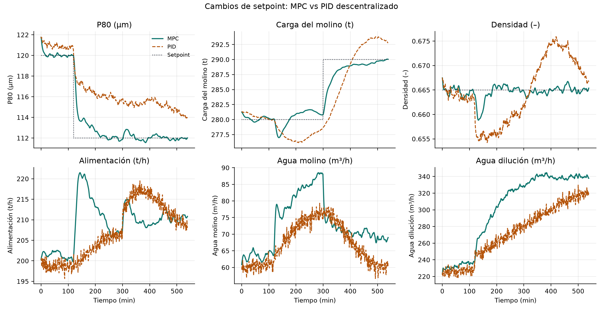
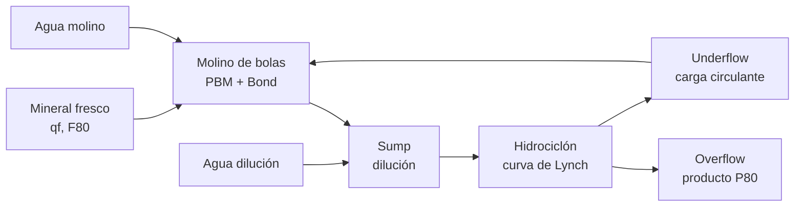
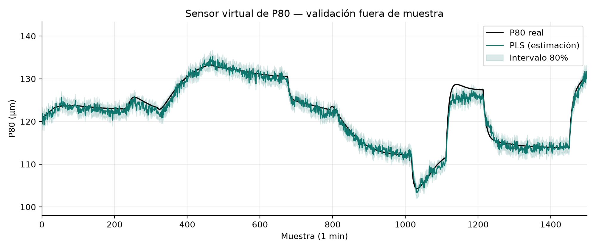
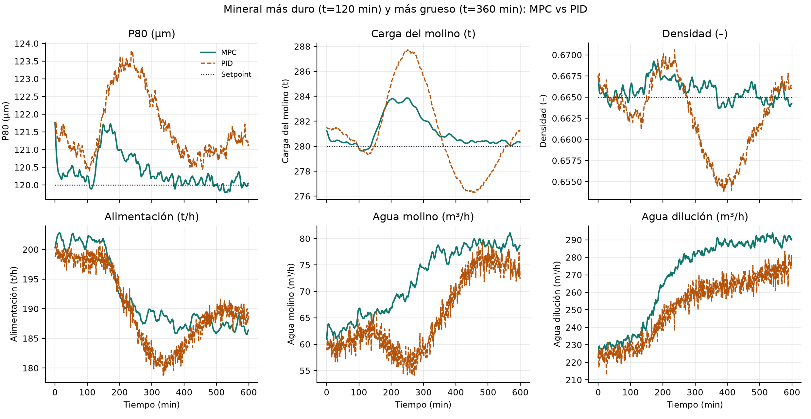

# Gemelo digital de un circuito de molienda-clasificación con MPC y sensor virtual de P80

Simulación en Python de un circuito industrial de molienda de bolas en circuito cerrado con
hidrociclón. El proyecto incluye un modelo fenomenológico, un controlador predictivo (MPC),
un sensor virtual de granulometría (soft sensor) y la generación automática de figuras y
métricas para evaluar el desempeño.

El caso de estudio está inspirado en plantas concentradoras del norte de Chile: molino de
bolas de gran diámetro, hidrociclones, agua de dilución y producto con P80 controlado.

**Autor:** Leví Gadiel Sojos González — Ingeniería Civil Electrónica, Universidad de
Concepción. Proyecto de portafolio orientado a automatización y control de procesos mineros.



---

## 1. Qué demuestra

- Modelado fenomenológico de un proceso minero: balance poblacional (PBM), cinética de
  molienda, clasificación en hidrociclón, tiempo de residencia variable y potencia de molino.
- Linealización numérica y diseño de un MPC MIMO con observador de Kalman y corrección de
  sesgo (offset-free).
- Comparación cuantitativa contra un PID descentralizado, el esquema típico en planta.
- Sensor virtual de P80 con validación temporal, comparación de PLS / Random Forest /
  Gradient Boosting e intervalos de confianza por predicción conformal.
- Código reproducible, figuras y métricas versionables.

---

## 2. Circuito simulado



Estados: 14 clases de tamaño del molino, agua del molino, 14 clases del sump y agua del
sump (30 estados). Entradas: alimentación fresca `qf` (t/h), agua al molino y agua de
dilución (m³/h). Salidas controladas: P80 del overflow (µm), carga del molino (t) y
densidad de alimentación al ciclón (fracción másica).

---

## 3. Modelo matemático

### 3.1 Molino: balance poblacional

Se discretiza el tamaño de partícula en 14 clases geométricas entre 16 mm y 10 µm. La
alimentación sigue una distribución Rosin-Rammler truncada en 16 mm (scalping) y
renormalizada, por lo que su P80 efectivo es aproximadamente 8.4 mm. Para cada clase `i`:

$$
\frac{dm_i}{dt} = \dot m_{mf}\,f_{mf,i} - \frac{m_i}{\tau_{eff}} + \sum_{j=1}^{n} b_{ij}\,k_j\,m_j - k_i\,m_i
$$

donde `m_i` es la masa retenida (t), `\dot m_{mf}` la alimentación al molino (fresco +
underflow) y `f_{mf,i}` su distribución másica.

Función de selección de Austin:

$$
k_i = a\left(\frac{x_i}{1000}\right)^{\alpha} \cdot h
$$

con `h` un factor de dureza del mineral (`h < 1` = más duro).

Función de ruptura acumulada de Austin:

$$
B(x) = \phi\left(\frac{x}{x_j}\right)^{\gamma} + (1-\phi)\left(\frac{x}{x_j}\right)^{\beta}
$$

La matriz `b_{ij}` se obtiene por diferencias de `B` y se normaliza por columna.

El tiempo de residencia depende del flujo volumétrico de pulpa, lo que reproduce el
comportamiento de un molino de rebalse: más flujo implica menos tiempo de molienda y un
producto más grueso.

$$
\tau_{eff} = \frac{V_m}{Q_{s,mf}/\rho_s + Q_{w,mf}/\rho_w}
$$

### 3.2 Sump

Tanque de mezcla perfecta donde se agrega agua de dilución:

$$
\frac{dm_{s,i}}{dt} = \frac{m_i}{\tau_{eff}} - \frac{m_{s,i}}{\tau_s},
\qquad
\frac{dM_{ws}}{dt} = \frac{M_w}{\tau_{eff}} + \dot V_{w,dil} - \frac{M_{ws}}{\tau_s}
$$

### 3.3 Hidrociclón

La alimentación se calcula desde el sump (`\dot m_{cf} = M_{ss}/\tau_s`). El tamaño de corte
depende del flujo y de la concentración de sólidos:

$$
d_{50} = d_{50,ref}\left(\frac{Q_{ref}}{Q_{cf}}\right)^{1/2}
\left(\frac{c_{cf}}{c_{ref}}\right)^{1/2}
$$

Curva de partición de Lynch (fracción de cada clase que va al underflow):

$$
y_i = \frac{e^{\alpha_c x_i/d_{50}} - 1}
{e^{\alpha_c x_i/d_{50}} + e^{\alpha_c} - 2}
$$

El underflow se reparte según `f_{u,i} = f_{cf,i} y_i / \sum_j f_{cf,j} y_j`; el overflow
es el complemento. El P80 del producto se obtiene interpolando el pasante acumulado en 80 %.

### 3.4 Potencia y presión

Potencia de molino tipo Bond con corrección por carga:

$$
P = P_0 + 10\,W_i\left(\frac{1}{\sqrt{P80}} - \frac{1}{\sqrt{F80}}\right)
\dot m_f \left(\frac{M_s}{M_{ref}}\right)^{0.2}
$$

Presión del ciclón:

$$
\Delta P = \Delta P_{ref}\left(\frac{Q_{cf}}{Q_{ref}}\right)^2
\frac{\rho_{slurry}}{\rho_{ref}}
$$

### 3.5 Punto de operación

| Variable | Valor |
|---|---|
| Alimentación fresca | 200 t/h |
| P80 efectivo de la alimentación | 8.4 mm |
| Agua al molino | 60 m³/h |
| Agua de dilución | 220 m³/h |
| P80 producto | 121.9 µm |
| Carga del molino | 281.3 t |
| Densidad al ciclón | 0.668 |
| d50 | 156.9 µm |
| Potencia | 2660 kW |
| Carga circulante | 252 % |
| Energía específica | 13.3 kWh/t |

---

## 4. Control predictivo

El modelo no lineal se linealiza por diferencias finitas en el punto de operación y se
discretiza con exponencial de matriz (retenedor de orden cero). El resultado es un modelo de
30 estados, 3 entradas y 3 salidas en variables de desviación:

$$
\Delta x_{k+1} = A\,\Delta x_k + B\,\Delta u_k,
\qquad
\Delta y_k = C\,\Delta x_k
$$

- **Observador aumentado:** filtro de Kalman estacionario sobre el estado extendido
  `[x, d]`, donde `d` son perturbaciones constantes de salida. Esto da seguimiento sin
  offset (offset-free) sin un integrador sintonizado a mano.
- **Optimización:** problema QP con CVXPY/OSQP, horizonte de predicción de 75 min, horizonte
  de control de 8 movimientos, restricciones de caja en entradas y salidas, límites de
  velocidad de movimiento y holguras penalizadas en las salidas.
- **Función objetivo:** seguimiento de P80, carga y densidad, más supresión de movimientos.

El PID de comparación es descentralizado con el pareo habitual en planta: agua de dilución →
P80, alimentación → carga, agua al molino → densidad.

---

## 5. Sensor virtual de P80

El analizador de tamaño es caro y requiere mantención. El sensor virtual estima el P80 a
partir de variables disponibles en el sistema de control: flujos, potencia del molino,
presión del ciclón, densidad, carga y carga circulante.

- 52 features: 9 variables medidas con 5 rezagos (0, 2, 5, 10 y 20 min) y 7 razones
  derivadas (energía por tonelada, razón agua/mineral, carga por tonelada, etc.).
- Separación temporal 70/30 (no aleatoria) para evitar fuga de información.
- Comparación de PLS (8 componentes), Random Forest y Gradient Boosting.
- Intervalo del 80 % por predicción conformal, calibrado con un 20 % del conjunto de
  entrenamiento.



---

## 6. Resultados

### 6.1 Sensor virtual

| Modelo | R² | RMSE (µm) | MAE (µm) | MAPE (%) |
|---|---|---|---|---|
| PLS (8 componentes) | 0.974 | 1.07 | 0.85 | 0.69 |
| Random Forest | 0.891 | 2.18 | 1.69 | 1.38 |
| Gradient Boosting | 0.946 | 1.55 | 1.25 | 1.02 |

El modelo final (PLS reentrenado con el 80 % del train y calibrado con el 20 % restante)
obtiene R² = 0.970, RMSE = 1.14 µm y MAE = 0.92 µm. El intervalo conformal del 80 % tiene
un ancho medio de 2.75 µm y una cobertura empírica de 77.3 %, levemente bajo el 80 %
nominal por la deriva temporal entre calibración y test.

El PLS es el mejor modelo: con 8 componentes captura la relación cuasi-lineal entre las
variables de operación y el P80, y generaliza mejor que los ensembles bajo deriva de
instrumentos. Las variables más relevantes son la densidad de alimentación al ciclón y la
potencia del molino, coherente con la física del proceso.

> Nota: el desempeño es optimista porque los datos provienen del propio gemelo digital.
> Con datos reales se esperaría un RMSE mayor y sería necesario reentrenar por campaña de
> mineral.

### 6.2 Lazo cerrado

Errores absolutos medios (IAE dividido por la duración de la simulación), con ruido de
medición en todas las señales:

| Escenario | Controlador | P80 (µm) | Carga (t) | Densidad (×10⁻³) | Asentamiento P80 (min) |
|---|---|---|---|---|---|
| Cambios de setpoint | **MPC** | **0.48** | **1.20** | **0.8** | **46** |
| Cambios de setpoint | PID | 3.08 | 2.89 | 5.4 | 180 |
| Disturbios de mineral | **MPC** | **0.40** | **1.17** | **1.1** | **58** |
| Disturbios de mineral | PID | 1.64 | 2.62 | 3.7 | 470 |

El MPC reduce el error de P80 en 6.4 veces ante cambios de setpoint y en 4.1 veces ante
disturbios, y reduce el tiempo de asentamiento de 180 a 46 min y de 470 a 58 min. También
mantiene la densidad mucho más cerca del valor deseado, evitando las oscilaciones lentas que
produce el PID descentralizado.

El costo es un uso algo mayor de agua de dilución (303 vs 273 m³/h en el escenario de
setpoints) y una energía específica levemente superior (13.71 vs 13.55 kWh/t): el MPC
produce un producto más fino y estable, lo que en planta suele compensar con creces el
costo energético por reducción de variabilidad y de reproceso.



### 6.3 Sensor virtual en el lazo

Al reemplazar el analizador por el sensor virtual (falla simulada a los 120 min), el lazo
permanece estable y el MPC mantiene el P80 en torno a 113.5 µm. El desempeño es peor que
con el analizador:

| Métrica | Valor |
|---|---|
| RMSE de estimación en el lazo | 1.64 µm |
| MAE de estimación en el lazo | 1.43 µm |
| Cobertura del intervalo del 80 % | 49.3 % |
| Asentamiento de P80 | 70 min |

Aparece un offset de aproximadamente 1.5 µm: el PLS fue entrenado con datos de excitación
en lazo abierto y la trayectoria de lazo cerrado desplaza la distribución de las variables.
El intervalo conformal, calibrado sobre esa misma distribución, también pierde cobertura.
En una planta real esto se corrige con muestras periódicas del analizador (actualización de
sesgo) o con recalibración adaptativa; el experimento muestra por qué un soft sensor no
debería reemplazar al analizador sin un mecanismo de corrección.

---

## 7. Figuras

| Figura | Archivo |
|---|---|
| Distribución de tamaño y curva de partición | `figures/fig_psd.png` |
| Respuestas en lazo abierto | `figures/fig_open_loop.png` |
| MPC vs PID ante cambios de setpoint | `figures/fig_closed_loop.png` |
| MPC vs PID ante disturbios de mineral (12 % más duro y 10 % más grueso) | `figures/fig_disturbance.png` |
| MPC con sensor virtual de P80 | `figures/fig_soft_sensor_loop.png` |
| Índices de desempeño | `figures/fig_performance.png` |
| Sensor virtual: serie temporal y banda conformal | `figures/fig_soft_sensor_timeseries.png` |
| Sensor virtual: paridad real vs estimado | `figures/fig_soft_sensor_parity.png` |
| Sensor virtual: distribución de residuos | `figures/fig_soft_sensor_residuals.png` |
| Sensor virtual: importancia por permutación | `figures/fig_soft_sensor_importance.png` |

---

## 8. Cómo ejecutar

```bash
cd molienda-mpc
python -m venv .venv
source .venv/bin/activate
pip install -r requirements.txt

# Todo el proyecto
./run_all.sh

# O por etapas
python src/model.py          # estado estacionario y linealización
python src/soft_sensor.py    # dataset, modelos e intervalos
python src/run_simulation.py # control, figuras y métricas

# Pruebas de cordura (balance de masa, PSD, linealización, MPC)
python -m unittest discover -s tests -v
```

Las figuras se guardan en `figures/` y las métricas en `reports/`.
La simulación completa tarda algunos minutos porque el MPC resuelve un QP por cada minuto
simulado.

---

## 9. Estructura

```
molienda-mpc/
├── src/
│   ├── model.py          # PBM, ciclón, Bond, estado estacionario, linealización
│   ├── simulation.py     # ruido, excitación PRBS, escenarios
│   ├── controllers.py    # PID, modelo lineal, Kalman, MPC
│   ├── soft_sensor.py    # dataset, features, PLS/RF/GBM, conformal
│   └── run_simulation.py # figuras y métricas finales
├── tests/
│   └── test_model.py     # pruebas de cordura
├── figures/
├── reports/
├── requirements.txt
└── run_all.sh
```

---

## 10. Limitaciones y siguientes pasos

- El modelo es fenomenológico y calibrado manualmente; no se ajustó con datos reales de
  planta. El siguiente paso natural es estimar parámetros de molienda y ciclón con datos
  históricos (mínimos cuadrados o filtro de Kalman extendido).
- El hidrociclón se modela en estado estacionario; un modelo dinámico de ciclón y de
  transporte mejoraría la predicción de perturbaciones rápidas.
- El MPC es lineal y usa un solo punto de operación. Para cambios amplios de throughput
  conviene un MPC no lineal (p. ej. CasADi/IPOPT) o programación por ganancias.
- Falta integrar la capa industrial: OPC UA, PLC, historiador y despliegue en tiempo real.
- El sensor virtual podría mejorar con un modelo híbrido (PLS + residual dinámico) y
  monitoreo de deriva.

---

## 11. Referencias

- Austin, L. G. (1971). A review: introduction to the mathematical description of grinding
  as a rate process. *Powder Technology*, 5(1), 1–17.
- Bond, F. C. (1961). Crushing and grinding calculations. *British Chemical Engineering*,
  6, 378–385.
- Lynch, A. J. (1977). *Mineral Crushing and Grinding Circuits*. Elsevier.
- Plitt, L. R. (1976). A mathematical model of the hydrocyclone classifier. *CIM Bulletin*,
  69(776), 114–123.
- Wills, B. A., & Napier-Munn, T. (2006). *Wills' Mineral Processing Technology* (7th ed.).
  Butterworth-Heinemann.
- Rawlings, J. B., Mayne, D. Q., & Diehl, M. (2017). *Model Predictive Control: Theory,
  Computation, and Design* (2nd ed.).
- Angelopoulos, A. N., & Bates, S. (2021). A gentle introduction to conformal prediction
  and distribution-free uncertainty quantification. *arXiv:2107.07511*.
